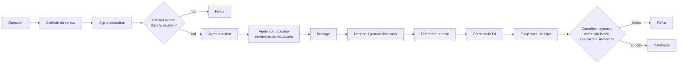

# Mêtis — architecture d'un orchestrateur multi-agents à garde-fous déterministes

Orchestrateur multi-agents en Python où les agents LLM proposent et où des règles hors LLM décident.
Chaque citation est vérifiée mot pour mot dans la source (PubMed, arXiv), sinon elle est refusée.

> Documentation uniquement. Le code source n'est pas publié : il a été perdu lors du vol d'un ordinateur et sera réécrit à partir de cette conception.

## Contexte et statut

Mêtis est un projet personnel, développé seul. Il comprend deux outils reliés par une étape humaine :

- **D0, audit documentaire** : à partir d'une question, collecte d'un corpus (PubMed, PMC en accès ouvert, arXiv), extraction d'affirmations citées, contrôles déterministes, juges LLM, recherche de réfutations, puis verdict de routage.
- **D1, forge** : à partir d'une commande rédigée par l'opérateur, un LLM léger écrit un corps de fonction, qui doit passer des contrôles (analyse syntaxique, exécution isolée, cas cachés, invariants) avant d'entrer dans un catalogue.

Statut (état du code au moment de sa perte, documenté le 12 novembre 2026) :

- D0 est implémenté et couvert par des tests rejouables sans réseau.
- D1 est décrit dans la spécification et partiellement présent dans le code de l'époque (schémas de commande, rôle du forgeron, choix du backend d'exécution isolée). Le pipeline d'exécution complet n'est pas encore implémenté.
- L'orchestration de D0 est une chaîne d'étapes explicite écrite en Python. **LangGraph n'est pas utilisé** dans la dernière version du code (voir « Décisions et compromis »).
- La boucle « hypothèse, génération de code, exécution isolée, verdict d'un agent critique » est l'objectif de conception de l'ensemble ; dans la dernière version du code, ses éléments existent séparément (juges, réfutation, schémas de D1), sans boucle de bout en bout.

## Architecture



Principes :

- Le flux de contrôle est écrit en code, pas décidé par un modèle. Chaque étape reçoit un état et en renvoie un nouveau, persisté après l'étape.
- Les agents LLM ont chacun un rôle étroit (extraire, auditer, contredire, router, forger) et une sortie validée par un schéma strict.
- Les décisions de rejet qui peuvent être prises sans LLM le sont sans LLM.

Détails et diagrammes complémentaires : [docs/architecture.md](docs/architecture.md).

## Garde-fous

| Garde-fou | Rôle | Hors LLM |
|---|---|---|
| Vérification de citation | Une citation doit apparaître mot pour mot dans le document source ; sinon l'affirmation est rejetée | oui |
| Pré-filtres | Écartent des cas évidents avant tout appel à un juge | oui |
| Schémas stricts | Chaque sortie d'agent est validée ; champs inconnus refusés ; objets immuables | oui |
| Transitions d'état contrôlées | Un statut ne peut changer que par une porte autorisée pour cette transition | oui |
| Budget par run | Un appel dont le coût maximal ferait dépasser le budget est refusé avant envoi | oui |
| Suivi des coûts par agent | Journal des appels (rôle, modèle, fournisseur, coût) écrit après chaque appel | oui |
| Refus du fournisseur | Jamais contourné (pas de nouvel essai, pas de modèle de repli) : fail-closed et mesuré | oui |
| Red-teaming | Tests où des citations pièges sont injectées pour vérifier que les portes les arrêtent | tests |
| Jeu d'évaluation des juges | Cas réels étiquetés, comparaison de modèles (faux positifs, faux rejets, coût) | mesure |

### Pourquoi le contrôle est hors du LLM

Un modèle de langage produit du texte plausible ; on ne peut pas garantir qu'il appliquera toujours une consigne, ni qu'il ne sera pas influencé par le contenu qu'il lit (document source, texte injecté). Une règle écrite dans un prompt reste une demande faite au modèle.

Une règle exécutée en code autour du modèle est différente : le modèle ne la lit pas, ne la négocie pas et ne peut pas la modifier. Il peut proposer une citation, il ne peut pas la déclarer exacte. La comparaison avec le texte source est faite par une fonction ordinaire, dont le résultat s'impose. Le modèle ne peut donc pas contourner une règle qu'il ne contrôle pas.

Corollaire : les juges LLM n'interviennent que là où le jugement sémantique est nécessaire, et après les contrôles mécaniques, jamais à leur place.

## Décisions et compromis

Résumé ; détail dans [docs/decisions.md](docs/decisions.md).

- Chaîne d'étapes explicite plutôt que LangGraph : lisibilité et déterminisme du flux, au prix d'un graphe d'états écrit à la main.
- Contrôles déterministes avant les juges LLM : moins d'appels et pas de faux accord, mais des rejets parfois stricts.
- Fail-closed : en cas de doute ou de refus du fournisseur, on rejette et on mesure plutôt que de contourner.
- Tests rejouables (réponses LLM enregistrées) : exécution sans réseau, mais enregistrements à régénérer quand un prompt ou un schéma change.
- Exécution isolée du code généré : sécurité d'abord, avec un mode local non isolé réservé à des usages explicites.

## Limites connues

- La vérification mot pour mot prouve la présence du texte, pas que la citation soit représentative ni correctement interprétée : l'interprétation reste confiée aux juges, donc faillible.
- Seules les sources accessibles aux collecteurs (PubMed, PMC en accès ouvert, arXiv) sont couvertes.
- Des refus de fournisseur ont été observés sur des sujets sensibles ; ils sont traités en rejet, ce qui peut écarter des cas valides.
- Le jeu d'évaluation des juges est de petite taille et ne permet pas de conclure à une garantie générale.
- D1 est partiel et la boucle complète hypothèse - code - exécution - critique n'est pas encore assemblée.

## Usage et résultats

Le code n'étant plus disponible, ce dépôt ne permet pas d'exécuter Mêtis. Le dossier [example/](example/) contient un petit module écrit à neuf pour illustrer le principe : `verify_quote(quote, source_text)` normalise les espaces puis exige que la citation figure exactement dans la source. Un second module, `claim_gate.py`, combine un schéma Pydantic immuable (champs inconnus refusés), une porte de transition d'état qui n'accepte « verified » que si la citation figure dans la source, et un test property-based avec `hypothesis`. Ces modules sont sous licence MIT.

```bash
cd example
python -m pip install pytest pydantic hypothesis
python -m pytest
```

Les 14 tests de l'exemple passent.


## Stack

Python (3.11 ou plus), Pydantic pour les schémas, httpx pour les collecteurs, pytest et hypothesis pour les tests, mypy en mode strict, accès aux modèles via OpenRouter, exécution isolée par conteneur ou bubblewrap (backend configurable). Aucune bibliothèque d'orchestration d'agents.

## Contact

[Nikola Gandon sur LinkedIn](https://www.linkedin.com/in/nikola-gandon/)
