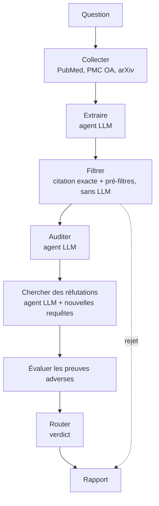
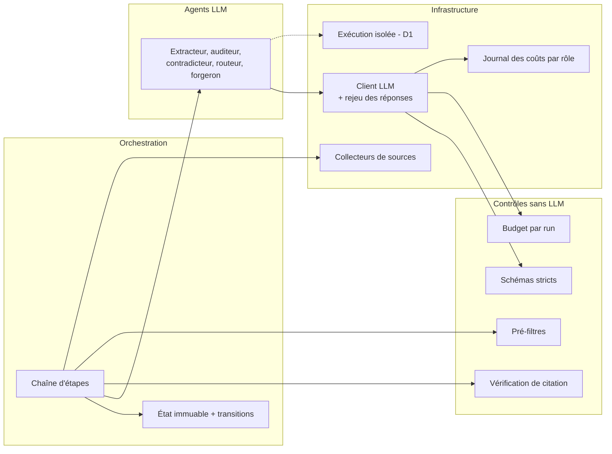
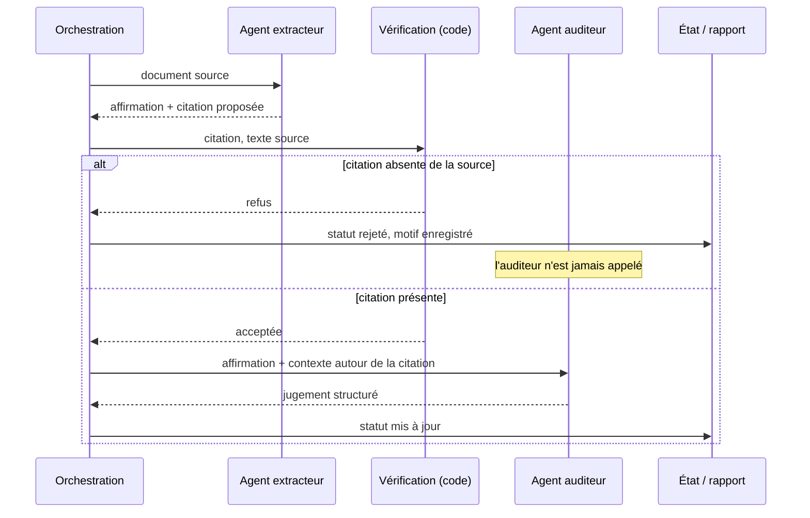

# Architecture de Mêtis

Documentation de conception. Aucun code du projet n'est reproduit.

## 1. Flux principal de D0

Légende : les étapes sont enchaînées par du code, l'état est persisté après chacune. Les rejets mécaniques sortent du flux sans solliciter de juge.

## 2. Composants

Légende : les agents n'ont accès qu'au client LLM, qui valide les sorties, applique le budget et journalise. Les contrôles sont appelés par l'orchestration, jamais par les agents. Le lien vers l'exécution isolée concerne D1.

## 3. Séquence d'un cas clé : citation inexacte

Légende : une citation reformulée ou inventée par le modèle est arrêtée par une comparaison de texte, avant tout jugement sémantique et sans dépendre de la bonne volonté du modèle.
